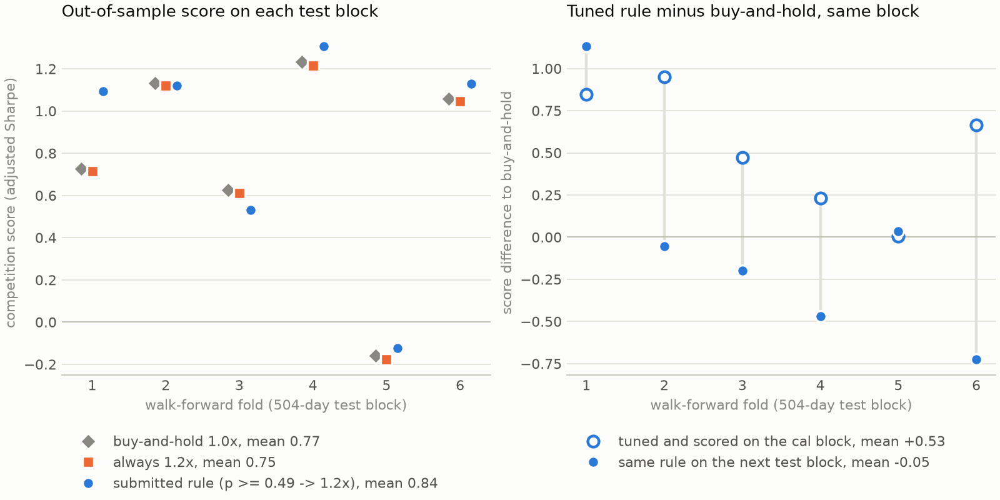

# Hull Tactical market timing (Kaggle bronze, top 10%)

Solo bronze in [Hull Tactical - Market Prediction](https://www.kaggle.com/competitions/hull-tactical-market-prediction):
rank 366 of 3,677 teams, private leaderboard **1.699**, against about 0.94 for buy-and-hold on
the same live window. My entry set a daily 0-2x position in the
S&P 500 from small GRU, attention-GRU and MLP direction classifiers. This repo rebuilds it as a
tested package with a purged walk-forward evaluation, no-lookahead tests and the host's exact
metric, and uses it to measure how much of a market-timing score is skill, market regime and
tuning.



*Left: the submitted rule against buy-and-hold and against holding 1.2x every day, on each of the
six 2-year test blocks (folds 1-6 cover date_id 6024-9047).
Right: a position rule tuned on the calibration block, minus buy-and-hold on the same block.
Hollow: tuned and scored on the calibration block. Filled: the same rule on the next test block.*

## TL;DR

- **Problem.** Each trading day, choose a position in [0, 2] in the S&P 500 (the rest in the
  risk-free asset). The score is a Sharpe ratio with penalties for volatility above 1.2x the
  market's and for returns below the market's ([metric.py](src/hull_timing/metric.py)).
- **Approach.** Up/down classifiers on the competition's 94 anonymised daily features plus
  leak-safe lagged returns: BiGRU, attention-BiGRU and MLP over a 20-day window, averaged, with
  logistic regression as a baseline. Probabilities map to leverage either through the submitted
  rule (p >= 0.49 -> 1.2x, else flat) or through percentile tiers (0 / 0.6 / 1.2 / 1.8x)
  calibrated on a held-out block.
- **Findings.**
  - On the live leaderboard window the entry scored 1.699; buy-and-hold, rebuilt from public
    prices and scored with the same metric, scores 0.94 (0.94-1.40 depending on the unpublished
    last scored day).
  - The submitted rule holds up out of sample: 0.84 ± 0.54 over six walk-forward blocks, ahead
    of buy-and-hold in 4 of 6, and ahead of holding 1.2x every day in 4 of 6. Its edge comes
    from the days it steps aside, not from leverage.
  - Tuning the position rule on the block it is scored on is worth +0.53 Sharpe over
    buy-and-hold in-sample and -0.05 on the next block. The evaluation separates the two.
  - Over six-month windows, buy-and-hold alone scores from -0.97 to 2.59, so a single
    leaderboard number is dominated by the market regime.

## Results

### Kaggle leaderboard (original notebooks)

Checked on 2026-09-29 through the Kaggle API (competition page and my submission list); see the
[leaderboard](https://www.kaggle.com/competitions/hull-tactical-market-prediction/leaderboard).

| Notebook | Models | Position rule | Private LB, final |
|---|---|---|---|
| `notebookaa1fc409de` | BiGRU + MLP + attention-BiGRU, averaged | p >= 0.49 -> 1.2x, else 0 | **1.699** |
| `notebookcf19501c3d` | attention-BiGRU with lagged returns | 4 percentile tiers, 0 / 0.6 / 1.2 / 1.8x | **1.613** |

The score was recomputed each month as new market data arrived. The same two notebooks
scored between -0.40 and 3.59 along the way (interim scores as listed in my submission list):

| Rerun | 2026-01-21 | 2026-02-19 | 2026-03-23 | 2026-04-20 | 2026-05-21 | 2026-06-25 (final) |
|---|---|---|---|---|---|---|
| ensemble (`aa1fc409de`) | 3.589 | 1.688 | -0.403 | 0.753 | 1.378 | 1.699 |
| attention-GRU (`cf19501c3d`) | 2.431 | 0.517 | -0.360 | 1.924 | 0.922 | 1.613 |
| buy-and-hold, rebuilt (see below) | -0.214 | 0.413 | -1.596 | 0.837 | 1.389 | 0.941 |

### Buy-and-hold on the live window

The host never released the live returns, so `hull-timing live-baseline`
([live.py](src/hull_timing/live.py)) rebuilds them from public data and checks the rebuild
against train.csv before using it:

- `forward_returns` is the next-day return of SPY's dividend-adjusted close; this reproduces the
  column to 1e-6 on 98% of the last 500 train rows.
- `risk_free_rate` is the 13-week T-bill yield (`^IRX`) / 100 / 252 on the same day; this
  reproduces it to 1e-9 on every matched row.
- On the 180-row public test set, buy-and-hold scores 1.126 from train.csv and 1.116 from the
  rebuild.

Scored rows run from the first trading day after the 2025-12-15 submission deadline to the last
data update before the final rerun. That last day was not published and mid-June was volatile,
so the score depends on it:

| Last scored row | 06-10 | 06-12 | 06-15 | 06-18 | 06-22 | 06-23 | 06-24 |
|---|---|---|---|---|---|---|---|
| Buy-and-hold | 1.090 | 1.398 | 1.299 | 1.181 | 0.953 | 0.941 | 0.956 |

The most likely cutoff is 06-23, the last row whose forward return was known the day before the
06-25 rerun (the rerun row in the table above uses the same rule for every month). On every
cutoff the entry's 1.699 is ahead, by 1.2x to 1.8x. Across the six reruns it led buy-and-hold
four times, most clearly in the down months (January, March), and trailed in April and May by
0.08 and 0.01. Full output: [`results/live_baseline.md`](results/live_baseline.md).

### Walk-forward evaluation (this repo)

Six expanding-window folds; each test block is 504 trading days and together they cover the
last 3,024 rows of `train.csv` (date_id 6024-9047). Inside each fold:
`train | 5-day gap | val 252 (early stopping) | gap | cal 252 (thresholds) | gap | test 504`.
Neural models are averaged over 3 seeds. Score = the competition metric on each test block;
mean ± std (ddof 1) over the 6 blocks. "vs buy-and-hold" is the per-fold difference to
buy-and-hold on the same block, with a paired t statistic (5 degrees of freedom, so |t| > 2.57
would be needed for p < 0.05). No setting was chosen by looking at test-block scores.

| Method | Position rule | Score, 6 folds | Range | Folds > B&H | vs buy-and-hold (t) | Test AUC | Mean position |
|---|---|---|---|---|---|---|---|
| Buy-and-hold (baseline) | 1.0x every day | 0.77 ± 0.51 | -0.16 to 1.23 | | | | 1.00 |
| Logistic regression (baseline, day-t features) | percentile tiers | 0.67 ± 0.31 | 0.24 to 1.01 | 2 / 6 | -0.10 (-0.79) | 0.505 | 0.99 |
| BiGRU | percentile tiers | 0.85 ± 0.66 | -0.07 to 1.57 | 3 / 6 | +0.08 (0.46) | 0.517 | 0.99 |
| Attention-BiGRU | percentile tiers | 0.60 ± 0.48 | 0.13 to 1.46 | 2 / 6 | -0.17 (-0.64) | 0.513 | 1.11 |
| MLP | percentile tiers | 0.61 ± 0.44 | 0.12 to 1.14 | 2 / 6 | -0.16 (-0.76) | 0.511 | 1.07 |
| Ensemble (mean of the three) | percentile tiers | 0.60 ± 0.44 | 0.09 to 1.31 | 2 / 6 | -0.17 (-0.81) | 0.516 | 1.09 |
| Ensemble | p >= 0.49 -> 1.2x | 0.84 ± 0.54 | -0.12 to 1.31 | 4 / 6 | +0.07 (1.15) | 0.516 | 1.12 |

**In-sample optimism, measured.** The position rule (3 thresholds, 4 leverages) is searched with
500 random trials to maximise the score on the cal block, then applied unchanged to the test
block:

| Ensemble, tuned rule | Score, 6 folds | Buy-and-hold on the same blocks | Difference |
|---|---|---|---|
| scored on the cal block it was tuned on | 2.10 ± 0.99 | 1.57 ± 1.05 | +0.53 |
| scored on the next test block | 0.72 ± 0.69 | 0.77 ± 0.51 | -0.05 (t -0.17) |

The tuned rule's score drops by 1.37 on average from the cal block to the next block, but 0.80
of that drop is the market: buy-and-hold also falls from 1.57 to 0.77 between the same blocks.
Measured against buy-and-hold, tuning is worth +0.53 in-sample and -0.05 out of sample.

Compute: 29.7 min for the main run and 24.8 min for the ablation, CPU only, 2 threads, no GPU.

### Ablations

Lagged-return features (17 of them: lags 1/2/3/5 and 5/20-day mean and std of the two
past-return columns, plus the previous day's risk-free rate), percentile-tier policy,
mean ± std over the 6 folds:

| Inputs | Logistic reg. | BiGRU | Attn-BiGRU | MLP | Ensemble |
|---|---|---|---|---|---|
| with lagged returns (96-99 inputs, main run) | 0.67 ± 0.31 | 0.85 ± 0.66 | 0.60 ± 0.48 | 0.61 ± 0.44 | 0.60 ± 0.44 |
| without (79-82 inputs, `configs/no_lags.yaml`) | 0.56 ± 0.27 | 0.58 ± 0.50 | 0.46 ± 0.30 | 0.53 ± 0.44 | 0.61 ± 0.57 |
| difference, paired by fold | +0.10 ± 0.21 | +0.27 ± 0.58 | +0.14 ± 0.40 | +0.08 ± 0.27 | -0.01 ± 0.20 |

| Ensemble position rule (main run) | Score, 6 folds | Folds > B&H | vs percentile tiers, paired (t) |
|---|---|---|---|
| percentile tiers fitted on the cal block | 0.60 ± 0.44 | 2 / 6 | |
| fixed p >= 0.49 -> 1.2x | 0.84 ± 0.54 | 4 / 6 | +0.24 ± 0.44 (1.36) |
| thresholds and leverages tuned on the cal block | 0.72 ± 0.69 | 2 / 6 | +0.12 ± 0.36 (0.84) |
| no model: 1.2x every day | 0.75 ± 0.51 | 0 / 6 | |

Every effect in both tables is smaller than its fold-to-fold spread. Holding 1.2x every day
scores slightly below 1.0x in every fold (0.75 vs 0.77): the score is a Sharpe ratio, so constant
leverage up to 1.2x barely changes it. Against always-1.2x, the 0.49 rule gains +0.09 ± 0.16
(t 1.39; higher in 4 folds, identical in the one fold where it never went flat, lower in 1).
That edge comes from the days it stayed flat (about 6% of days; 17% and +0.38 in the first
fold), not from leverage, and it is not significant.

## Reproduce in 3 commands

```bash
pip install -e ".[dev]"        # Python >= 3.10; pinned versions in requirements-lock.txt
make data                      # needs `pip install kaggle` and an account that accepted the rules
make run ablation figure       # CPU only; about 30 + 25 min on 2 threads
```

`make run` writes `results/*.csv` (per-fold scores, per-seed scores, fit logs, 126-day window
scores) and prints `results/summary.csv`; this run printed 0.60 for the ensemble and 0.77 for
buy-and-hold. Seeds are fixed in `configs/default.yaml`; bit-exact agreement across CPU types
and thread counts has not been checked. `hull-timing summary` rebuilds `summary.csv` from
`folds.csv` without retraining. The always-1.2x rows need no model; they were scored after the
run with the same code (`evaluate.constant_rows`), which `make run` now includes. `make test`
runs the synthetic-data tests in 10-25 s on one CPU thread; no data or network needed.
`make live-baseline` downloads SPY and `^IRX` daily data from Yahoo Finance (a few seconds) and
rewrites `results/live_baseline.md`; it needs `train.csv` for the reconstruction check.

## Layout

```
src/hull_timing/
  features.py   leak-safe lagged returns, causal forward-fill, 20-day windows
  models.py     BiGRU, attention-BiGRU, MLP (PyTorch)
  train.py      purged walk-forward folds, training loop with early stopping
  policy.py     probability -> 0..2x tiers; percentile calibration; tuned-threshold search
  metric.py     the competition's volatility-adjusted Sharpe
  live.py       buy-and-hold on the live leaderboard window, rebuilt from public prices
  evaluate.py   per-fold scoring, shift-null test, 126-day window scores
  pipeline.py · cli.py · plot.py · config.py
configs/        default.yaml, no_lags.yaml
tests/          synthetic-data tests, including no-lookahead checks
results/        CSVs behind every number in this README
```

## Engineering choices in the rewrite

- **Each decision gets its own block.** Early stopping uses `val`, thresholds use `cal`, and only
  `test` is scored.
- **Causal preprocessing.** Only forward fill is used (no backward fill over the history), and
  scaling and feature selection are fitted on the training rows of each fold.
- **Lag features stay current.** Lagged returns are recomputed from the return series for every
  day, matching the live feed.
- **Tests for lookahead.** `tests/test_features.py` changes every raw feature after day t and
  every target from day t on, and checks that feature rows up to t are unchanged;
  `tests/test_train.py` perturbs later feature and target rows and checks that test-block
  predictions up to day t are unchanged after training. Adding a backward fill makes the
  feature test fail; a rolling mean on the unshifted target makes both fail.
- **Scaling survives regime shifts.** Columns that are constant in a fold's training rows are
  dropped and z-scores are clipped at ±10, so a near-constant feature cannot explode on later rows.
- **The metric follows the host's public scoring code** (Kaggle metric
  `hull-competition-sharpe`) and matches it to 3e-13 on 300 random windows of the training data.
- Architectures are slightly smaller (hidden 64 instead of 96-128, LayerNorm heads, 20-day
  windows for every model) so the whole evaluation runs on 2 CPU threads in under an hour.

## Limitations

- **Six folds is a small sample.** Fold-to-fold and seed-to-seed spread are as large as the gaps
  between methods, so none of the differences above is statistically significant. All folds come
  from one market (the S&P 500) with anonymised dates.
- **Daily direction is a weak signal.** Mean test AUC is 0.505-0.517 per model; the submitted
  rule's edge comes from the few days it stays flat, not from leverage.
- **Scope.** The 1.699 / 1.613 belong to the original notebooks; the rewrite has not been scored on
  Kaggle, where the competition has closed. No transaction costs are modelled, as in the
  competition.

## Credits

- Solo competition entry; the Kaggle notebooks are my own work.
- Data and task: Hull Tactical and Kaggle. The data are not redistributed; `make data`
  downloads them.
- Metric: `metric.py` follows the host's public scoring code (Kaggle metric
  `hull-competition-sharpe`).

## License

MIT, see [LICENSE](LICENSE).
